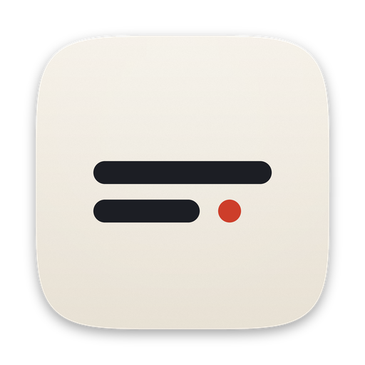

# 随手记 QuickNote



一个轻量的 macOS 原生小工具（SwiftUI + AppKit），用来随手记录零碎信息：客户资料、项目备忘、临时文本、截图……

## 功能

- **全局快捷键**：默认 `⌥ Space` 呼出「随手记一笔」浮动便笺，`⌃⌥ Space` 打开 / 隐藏主窗口，`⌃⌥ V` 直接打开剪贴板历史。设置里可以录制新组合或选推荐组合；如果和系统快捷键（Spotlight、输入法切换、截图等）、其他应用或另一个快捷键冲突，会提示并且不生效。不需要“辅助功能”权限。
- **项目主题**：左侧栏新建项目（名称 + 图标 + 颜色），每个项目独立存放笔记；右键项目可以改颜色、编辑、导出；未归类的进入“收件箱”。
- **默认标题**：新建笔记自动生成标题（日期时间，或“项目名 · 日期时间”，可在设置里改），标题会自动选中，直接输入即可替换。
- **标签**：笔记可加多个标签（回车或逗号分隔），侧栏按标签浏览，支持重命名 / 删除标签；搜索时输入 `#标签` 只匹配标签。
- **结构化字段**：“字段名 + 内容”，每个字段一键复制；内置“客户信息 / 联系人 / 账号信息”模板。
- **图片附件**：笔记里可以拖入、选择或粘贴图片。
- **剪贴板历史（后台自动记录）**：
  - 文本、图片（截图、网页拷贝的图片、访达里复制的图片文件）都会记录，并标明来源应用；
  - 图片用系统自带的 Vision 识别文字（中英文），截图里的文字也能搜到；
  - 重复内容自动合并到最前；可置顶、删除、双击复制、转存为笔记、另存图片；
  - 密码管理器标记为隐藏的内容、在本 App 内复制的内容不会记录。
- **全局搜索**：同时搜笔记（标题、正文、字段、标签、项目名）和剪贴板（含图片识别出的文字），多关键词，命中文字高亮。
- **Markdown 导出**：单条笔记导出 / 复制为 Markdown；整个项目、某个标签或全部笔记批量导出（按项目分文件夹，带 YAML 头，字段转为表格，图片放进 `assets/`）。
- **iCloud 同步**：设置 › 同步与数据 里切换到“iCloud 云盘”，多台 Mac 自动同步笔记、项目、标签和附件。
- 菜单栏图标、可隐藏 Dock 图标、登录时自动启动。

## 视觉

「素笺」：米白纸面、墨色文字、朱砂点缀，宋体标题与正文，衬线数字日期；项目用彩色印章标识；深色模式自动切换为墨色笺。正文支持 Markdown 实时渲染（# 标题、**加粗**、*斜体*、- 列表、- [ ] 待办、> 引用、--- 分隔、`代码`、[链接](url)）。

## 快捷键

| 快捷键 | 作用 |
| --- | --- |
| `⌥ Space`（可改） | 随手记一笔：浮动便笺，回车存下（全局） |
| `⌃⌥ Space`（可改） | 打开 / 隐藏主窗口（全局） |
| `⌃⌥ V`（可改） | 打开剪贴板历史（全局） |
| `⌘ N` | 新建笔记（放进当前选中的项目 / 标签） |
| `⇧ ⌘ N` | 新建项目 |
| `⌘ F` | 搜索 |
| `⇧ ⌘ Y` | 剪贴板历史 |
| `⌃ ⌘ S` | 显示 / 隐藏侧栏 |
| `⇧ ⌘ E` | 导出全部笔记为 Markdown |
| `⌫` | 删除选中的笔记 / 剪贴板条目 |
| `⌘ ,` | 设置 |

## 构建与运行

要求：macOS 13 Ventura 或更新版本，Xcode 15+（或 Command Line Tools）。

```bash
./build.sh                       # 生成 build/QuickNote.app
open build/QuickNote.app         # 运行
cp -R build/QuickNote.app /Applications/   # 安装
```

开发时也可以直接 `open Package.swift`，用 Xcode 打开并运行。

## 数据

| 内容 | 位置 |
| --- | --- |
| 笔记、项目、标签（本机模式） | `~/Library/Application Support/QuickNote/data.json` |
| 笔记、项目、标签（iCloud 模式） | `iCloud 云盘/QuickNote/data.json` |
| 笔记图片附件 | 上述目录下的 `Attachments/` |
| 剪贴板历史（始终只在本机） | `~/Library/Application Support/QuickNote/clips.json` 与 `ClipImages/` |

### 关于 iCloud 同步

为了不需要付费开发者账号，同步通过 iCloud 云盘里的文件夹实现，没有用 CloudKit：

- 每台 Mac 都需要登录同一个 Apple ID 并打开 iCloud 云盘；
- App 每 3 秒检查一次文件变化，按笔记粒度合并：同一条笔记两边都改过时保留较新的版本，删除操作也会同步；
- 切换存储位置时，旧位置的数据会保留作为备份；新位置已有数据（另一台 Mac 先开启）时会合并，而不是覆盖。

## 代码结构

```
Sources/QuickNote/
├── QuickNoteApp.swift      入口、通知名、剪贴板读写工具
├── AppDelegate.swift       窗口、菜单栏图标、主菜单、显示/隐藏逻辑
├── HotKeyManager.swift     Carbon 全局快捷键、系统快捷键冲突检测
├── AppSettings.swift       偏好设置（UserDefaults）
├── ClipboardMonitor.swift  剪贴板监听（文本 / 图片 / 文件）
├── Images.swift            缩略图缓存、OCR 文字识别
├── MarkdownExporter.swift  Markdown 导出
├── Models.swift            Project / Note / ClipItem 数据模型
├── Store.swift             数据读写、iCloud 同步合并、增删改、搜索
└── Views/                  SwiftUI 界面（侧栏、笔记、剪贴板、搜索、设置）
```
